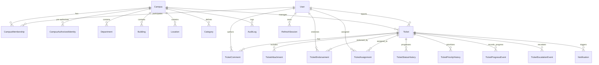

# Unifix - Database Specification & Schema Architecture

This document specifies the PostgreSQL relational database design for **Unifix**, managed via **Prisma ORM** and hosted on **Supabase PostgreSQL**.

---

## 1. Architectural Principles

1. **Strict Multi-Tenant Scoping**: `Campus` is the fundamental tenant boundary. Every critical entity (`Ticket`, `Department`, `Building`, `Location`, `Category`, `CampusAuthorizedIdentity`, `CampusMembership`) holds a foreign key to `Campus`.
2. **UUID Primary Keys**: All records use UUIDv4 primary keys generated by `@default(uuid())`.
3. **Data Immutability & Audit Trail**: Meaningful operational lifecycle events (`TicketStatusHistory`, `TicketPriorityHistory`, `TicketProgressEvent`, `TicketEscalationEvent`, `AuditLog`) are append-only.
4. **Historical Preservation**: Resolved, closed, duplicate, or rejected tickets are never purged or soft-deleted from the database; they transition out of active work queues while remaining accessible to authorized searches and analytical aggregates.
5. **Session Security in Database**: Refresh tokens are not stored in plaintext; only their HMAC-SHA256 digests are stored in `RefreshSession` with client IP and User-Agent metadata.

---

## 2. Entity-Relationship Overview

---

## 3. Database Models

### 3.1 Tenancy & Identity Registry

#### `Campus`
Represents an autonomous educational institution or campus facility.
- `id`: UUID (Primary Key)
- `name`: String
- `code`: String (Unique, e.g. `PSTC`, `MADI`, `HVU`)
- `isActive`: Boolean (Default: true)
- `address`, `latitude`, `longitude`, `timezone`: Strings/Floats
- `createdAt`, `updatedAt`: Timestamps

#### `CampusAuthorizedIdentity`
The pre-approved whitelist of eligible campus members (students, staff, maintenance technicians, campus managers). Used during onboarding before account creation.
- `id`: UUID
- `campusId`: UUID (Foreign Key to Campus)
- `identifier`: String (Normalized lowercase email or phone number)
- `identifierType`: Enum (`EMAIL`, `PHONE`)
- `expectedRole`: Enum (`REPORTER`, `MANAGEMENT`, `SUPERMANAGEMENT`)
- `externalId`: String (Student or employee ID)
- `firstName`, `lastName`, `department`: Strings
- `isActive`: Boolean
- Unique constraint: `@@unique([campusId, identifier])`

#### `User`
The authenticated system user.
- `id`: UUID
- `email`: String (Unique, nullable)
- `phone`: String (Unique, nullable)
- `firstName`, `lastName`: Strings
- `isActive`: Boolean
- `isAnonymous`: Boolean (Default user preference)

#### `CampusMembership`
Associates a User with a specific Campus and assigns their role in that tenant context.
- `id`: UUID
- `userId`: UUID (Foreign Key to User)
- `campusId`: UUID (Foreign Key to Campus)
- `role`: Enum (`REPORTER`, `MANAGEMENT`, `SUPERMANAGEMENT`)
- `isActive`: Boolean
- Unique constraint: `@@unique([userId, campusId])`

#### `RefreshSession`
Stores active opaque refresh token hashes for session rotation and reuse attack mitigation.
- `id`: UUID
- `userId`: UUID (Foreign Key to User)
- `tokenHash`: String (HMAC-SHA256 digest of refresh token, Unique)
- `expiresAt`: DateTime
- `isRevoked`: Boolean (Default: false)
- `userAgent`, `ipAddress`: Strings

---

### 3.2 Facilities & Metadata

- **`Department`**: Organizational department (e.g., Facilities & Maintenance, IT Services, Security, Housing).
- **`Building`**: Physical structure on campus.
- **`Location`**: Specific room, floor, or outdoor zone (e.g., "Turing Engineering Center Room 204").
- **`Category`**: Issue classification (e.g., Plumbing, Electrical, HVAC, Safety & Security, IT).

---

### 3.3 Core Ticket Management

#### `Ticket`
The central work entity.
- `id`: UUID
- `campusId`: UUID (Foreign Key to Campus, indexed)
- `reporterId`: UUID (Foreign Key to User, nullable for anonymous persistence)
- `categoryId`: UUID (Foreign Key to Category)
- `locationId`: UUID (Foreign Key to Location, nullable)
- `userLocationText`: String (Manual or AI-extracted location string)
- `type`: Enum (`ISSUE`, `SERVICE_REQUEST`)
- `title`: String
- `description`: Text
- `severity`: Enum (`MINOR`, `MODERATE`, `MAJOR`, `CRITICAL`)
- `impact`: Enum (`INDIVIDUAL`, `GROUP`, `BUILDING`, `CAMPUS`)
- `urgency`: Enum (`LOW`, `NORMAL`, `HIGH`, `URGENT`)
- `suggestedPriority`: Enum (`LOW`, `MEDIUM`, `HIGH`, `CRITICAL`) — AI suggestion
- `officialPriority`: Enum (`LOW`, `MEDIUM`, `HIGH`, `CRITICAL`) — Official management setting
- `status`: Enum (`OPEN`, `ACKNOWLEDGED`, `UNDER_REVIEW`, `ASSIGNED`, `IN_PROGRESS`, `WAITING`, `RESOLVED`, `CLOSED`, `REJECTED`, `DUPLICATE`)
- `isAnonymous`: Boolean (When true, ordinary users see sanitized "Anonymous Reporter")
- `duplicateOfId`: UUID (Self-relation to canonical Ticket if marked duplicate)
- `stageStartedAt`: DateTime (Controls the 21-day stage countdown timer)
- `acknowledgedAt`, `startedAt`, `resolvedAt`, `closedAt`: Nullable timestamps
- `resolutionSummary`: Text (Mandatory >= 10 chars when marked RESOLVED)

---

### 3.4 Ticket Collaboration & Lifecycle

- **`TicketEndorsement`**: Unique ("I have this issue too") endorsements. Enforces `@@unique([ticketId, userId])` to prevent vote inflation.
- **`TicketComment`**: Public and internal notes. `isInternal` comments are hidden from ordinary student reporters.
- **`TicketAttachment`**: Private Supabase Storage object references with MIME types, file size, and upload ownership.
- **`TicketAssignment`**: Assigns tickets to responsible maintenance departments or individual staff.
- **`TicketStatusHistory`**: Complete audit of all status changes with previous status, new status, actor, and reason.
- **`TicketPriorityHistory`**: Audit trail of management priority overrides with mandatory reason.
- **`TicketProgressEvent`**: Formal progress records (e.g. diagnostic completed, replacement part ordered) that restart the 21-day stage timer (`resetsStageTimer: true`).
- **`TicketEscalationEvent`**: Idempotent escalation records generated when a ticket remains in any progress stage for >21 days (or >48 hours for critical issues).
- **`Notification`**: In-app alerts for users and managers with unread status tracking.
- **`AuditLog`**: System-level administrative audit records.

---

## 4. Database Migrations & Seeds

### Execution Commands
- **Generate Client**: `npx prisma generate`
- **Push Schema**: `npx prisma db push`
- **Seed Fixtures**: `npm run seed`

### Seeded Development Fixtures
1. **Pacific Science & Tech Campus (`PSTC`)**:
   - Departments: Facilities, IT Support, Security, Electrical, Plumbing, HVAC
   - Identities:
     - `manager.sarah@pstc.test` (Sarah Connor - Campus Management)
     - `tech.bob@pstc.test` (Bob Vance - Maintenance Technician)
     - `student.alex@pstc.test` (Alex Mercer - Student Reporter)
     - `prof.elena@pstc.test` (Elena Rostova - Faculty Reporter)
2. **Metropolitan Arts & Design Institute (`MADI`)**:
   - Identities: `manager.david@madi.test`, `student.clara@madi.test`
3. **Highland Valley University (`HVU`)**:
   - Identities: `superadmin.marcus@unifix.test` (Supermanagement)
